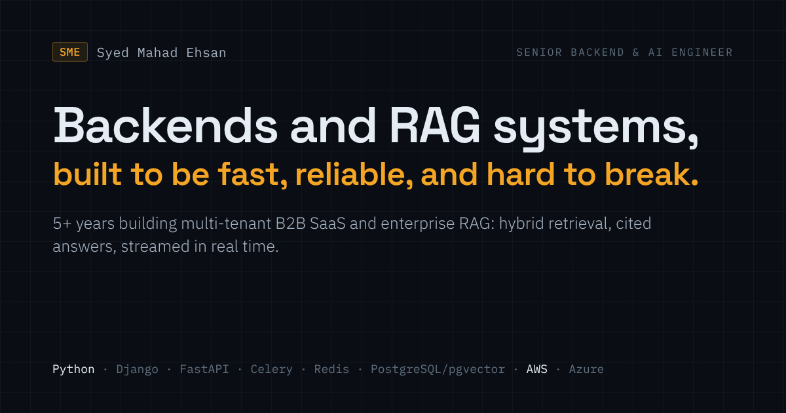

# Syed Mahad Ehsan · Portfolio

[](https://mahadehsan.com)
[](https://linkedin.com/in/syed-mahad-ehsan)
[](https://github.com/SyedMahad)

> Senior Backend & AI Engineer · Python · Django · FastAPI · RAG · PostgreSQL/pgvector · AWS · Azure



---

## What's in here

Personal portfolio for [mahadehsan.com](https://mahadehsan.com). Fully static: no framework, no npm. A small
Python script generates the case-study and write-up pages so they share one nav and footer.

```
.
├── index.html                  # homepage
├── styles.css                  # all styling, including light/dark theme
├── script.js                   # reveal, pipeline animation, contact form, theme, headline fit, years of experience
├── content/
│   ├── systems/<slug>.html     # case-study bodies (edit these)
│   └── fixes/<slug>.html       # fix write-up bodies (edit these)
├── systems/<slug>/index.html   # GENERATED case-study pages
├── fixes/<slug>/index.html     # GENERATED fix write-up pages
├── tools/build_systems.py      # page + homepage-card generator
├── sitemap.xml · robots.txt
└── images/og-image.png         # social card (1200×630)
```

## Editing case studies and fixes

1. Edit the body in `content/systems/<slug>.html` or `content/fixes/<slug>.html`.
2. Edit titles, card summaries, metrics, chips or order in `PAGES` / `FIXES` in `tools/build_systems.py`.
3. Run `python3 tools/build_systems.py`. It rewrites every generated page and the homepage cards between the
   `<!-- systems:cards -->` / `<!-- fixes:cards -->` markers.
4. Commit both the content and the generated files.

Never edit files under `systems/` or `fixes/` directly; they are overwritten on the next build.

## Sections

| Route | Content |
|---|---|
| `/work` | Roles and headline results, each linked to its case study |
| `/systems` | 6 case-study cards → full pages at `/systems/<slug>/` |
| `/fixes` | AI-generated code made production-ready → write-ups at `/fixes/<slug>/` |
| `/stack` | Six capabilities linked to their proof, full toolkit, education |
| `/contact` | Contact form (Formspree), 20-min intro call (Cal.com), direct links |

## Features

- **Dark / light mode:** persists to `localStorage`, respects OS preference on first visit
- **Self-fitting headline:** 2 lines on tablet/desktop, 3 on phones
- **Auto-updating experience:** years of experience tick up every 1 March
- **Inline SVG diagrams and charts** that follow the theme
- **Scroll-reveal animations** that respect `prefers-reduced-motion`
- **Contact form** via [Formspree](https://formspree.io) with honeypot spam protection;
  keep **Restrict to Domain → mahadehsan.com** set in the Formspree dashboard

## Deploy

Static files served from the repo root. Any static host works (GitHub Pages, Caddy, nginx). Directory URLs such
as `/systems/rag/` resolve to `index.html` with no server rules needed.

## Contact

**mahad.ehsan@gmail.com** · [mahadehsan.com](https://mahadehsan.com) · [Book a call](https://cal.com/syed-mahad-ehsan/intro)
